<p align="center">
  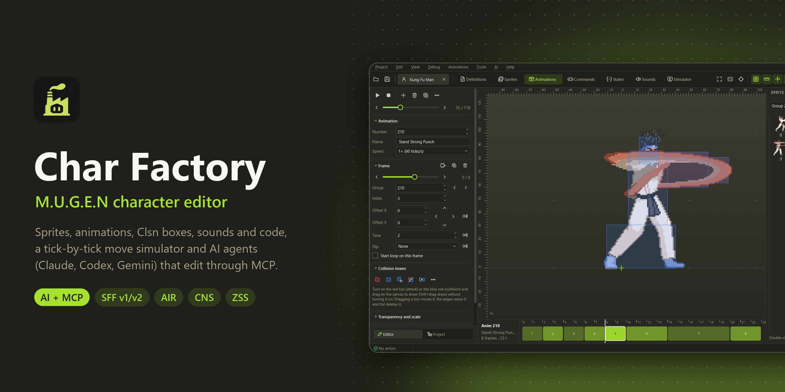
</p>

<p align="center">
  <a href="../../releases/latest"></a>
  <a href="../../actions/workflows/ci.yml"></a>
  <a href="../../releases"></a>
  <a href="#ai-agents-and-mcp"></a>
  <a href="LICENSE"></a>
</p>

<p align="center">
  A free, open source editor for <b>M.U.G.E.N</b> and <b>Ikemen GO</b> characters. Inspired by <a href="https://virtualltek.com/">Fighter Factory</a>.<br>
  Sprites, animations, collision boxes, sounds and code in one window, a simulator that plays<br>
  your moves tick by tick, and <b>AI agents</b> (Claude, Codex, Gemini) that edit the character with you.
</p>

<p align="center">
  <b><a href="../../releases/latest">Download for Windows</a></b> ·
  <a href="#ai-agents-and-mcp">AI and MCP</a> ·
  <a href="#what-makes-it-different">What makes it different</a> ·
  <a href="#the-editors">The editors</a> ·
  <a href="#command-line">Command line</a> ·
  <a href="#development">Development</a>
  <br>
  <sub>English · Español · Português (Brasil)</sub>
</p>

## Get started

1. Download `Char-Factory-...-windows.zip` from the **[latest release](../../releases/latest)**.
2. Extract it anywhere and open **`Char Factory.exe`**. Nothing to install.
3. Open a character's `.def`, or drop a `.def`, `.zip`, `.rar` or `.7z` on the window.

The first launch asks for the language and the theme. If the character lives inside your MUGEN or
Ikemen GO folder, **Run in the engine** (<kbd>Ctrl</kbd>+<kbd>R</kbd>) finds that engine by itself;
**Debug → Run in MUGEN / Run in Ikemen GO** tests the same character in the other one.

## AI agents and MCP

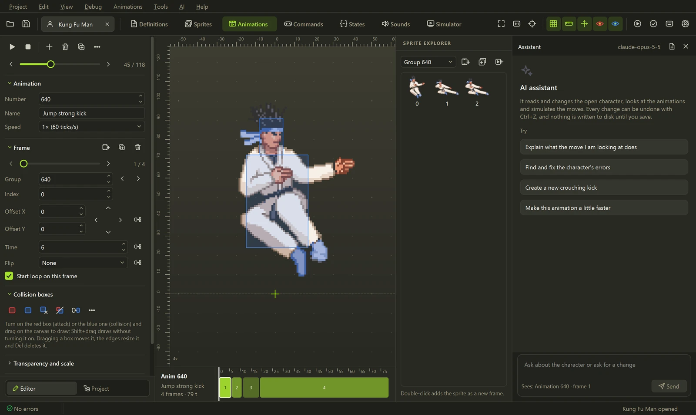

<p align="center"><sub>One request, a new move: the assistant picks the poses, builds the animations and states, wires
the command, fixes the kick that missed and shows the result in the simulator. Real tools on Kung Fu Man.</sub></p>

Ask for a move in plain words and an AI agent builds it in the open character: it reads the states,
**looks at the animations** to pick the right poses, writes the code, fits the collision boxes and
**runs the move in the simulator** to confirm it hits before telling you it is done. Every change
shows up in the editor at once, <kbd>Ctrl</kbd>+<kbd>Z</kbd> undoes it, and nothing is written to disk
until you save.

<table>
  <tr>
    <td width="50%" valign="top">
      <b>Built-in assistant</b> · <kbd>Ctrl</kbd>+<kbd>Shift</kbd>+<kbd>A</kbd><br><br>
      A side panel that talks to <b>Claude</b>, <b>OpenAI</b> (GPT) or <b>Gemini</b> with your API key,
      or to a local model through Ollama or LM Studio. It knows what you are looking at (the
      statedef under the cursor, the animation and frame), so <i>"make this faster"</i> just works.
    </td>
    <td width="50%" valign="top">
      <b>Your own agent through MCP</b><br><br>
      <b>Claude Code</b>, <b>Codex</b>, <b>Claude Desktop</b>, <b>Gemini CLI</b>, <b>Cursor</b> or
      <b>VS Code</b> connect to Char Factory and edit the character on screen with <b>your own
      subscription</b>, no API key needed. Local only (<code>127.0.0.1</code>) and protected by a token.
    </td>
  </tr>
</table>

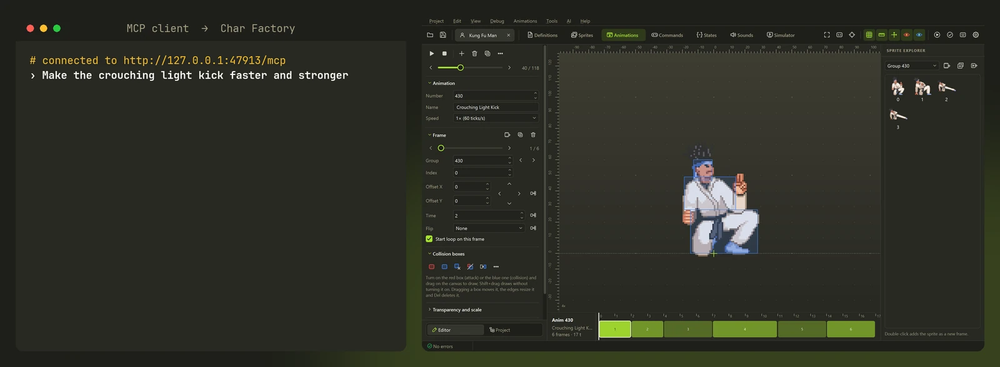

<details>
<summary><b>What the agent can do (35 tools)</b></summary>
<br>

| | Tools |
|---|---|
| **Understand a move** | `get_move` (statedef, animations, input and verdict in one call), `list_states`, `list_animations` with search, `test_command` (which state an input reaches) |
| **See** | `view_animations` (contact sheet of candidate poses), `view_animation`, `view_sprite` |
| **Create** | `create_move` (statedef, command and `[Statedef -1]` entry), `build_animation` (boxes fitted to each sprite), `set_state`, `add_controller`, `add_command` |
| **Change precisely** | `edit_state` (one parameter, comments kept), `edit_animation` (frames, timing, boxes), `set_constant` |
| **Check** | `simulate_state` (frame data and the path: where the character goes, from which side it hits), `validate_character`, `mugen_reference`, `mugen_guide` |

Safety nets come built in: an existing move is never overwritten by accident, an input another move
already uses is refused with the free ones listed, AIR boxes the parser would drop are rejected, and
a reply cut by the output limit is never applied half-written.

</details>

### Set it up

The fastest way: **AI → Connect an agent (MCP)**, tick **Run the MCP server**, pick your client and
copy the configuration it shows (the URL and your token are already filled in). Keep Char Factory
open with the character loaded while the agent works.

<p align="center">
  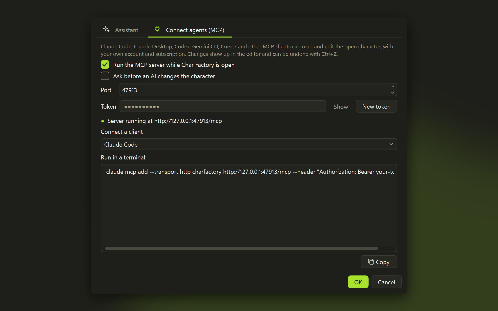
</p>

<details open>
<summary><b>Claude Code</b> (uses your Claude subscription)</summary>
<br>

```powershell
claude mcp add --transport http charfactory http://127.0.0.1:47913/mcp --header "Authorization: Bearer <your token>"
```

Then start `claude` and ask, for example: *"Open the character in Char Factory, look at the crouching
kicks and make a new one that hits low"*. `/mcp` shows that `charfactory` is connected.

Without the window, Claude Code can also run the server itself on a character:
`claude mcp add charfactory -- "C:\path\to\Char Factory.exe" --mcp "C:\path\to\char.def"`.

</details>

<details>
<summary><b>Codex</b> (uses your ChatGPT subscription)</summary>
<br>

Add to `~/.codex/config.toml`:

```toml
[mcp_servers.charfactory]
url = "http://127.0.0.1:47913/mcp"
http_headers = { "Authorization" = "Bearer <your token>" }
```

Then run `codex` and ask for the change. Or launch the server over stdio instead:
`codex mcp add charfactory -- "C:\path\to\Char Factory.exe" --mcp`.

</details>

<details>
<summary><b>Claude Desktop, Gemini CLI, Cursor, VS Code</b></summary>
<br>

The **Connect a client** list in the same tab has the exact snippet for each one. Claude Desktop
starts `Char Factory.exe --mcp`, which connects to the open window (add it to
`claude_desktop_config.json` under *Settings → Developer → Edit Config* and restart Claude). Any other
client speaks Streamable HTTP to `http://127.0.0.1:47913/mcp` with the header
`Authorization: Bearer <your token>`.

</details>

<details>
<summary><b>Built-in assistant with an API key</b> (Claude, OpenAI or Gemini)</summary>
<br>

1. **AI → AI settings…**, tab **Assistant**.
2. Pick the provider: **Anthropic (Claude)**, **OpenAI (GPT)**, **Google Gemini**, or
   **OpenAI-compatible** for OpenRouter, Ollama or LM Studio (set its base URL).
3. Paste the key (**Get a key** opens the provider's page) and press **Test connection**, which also
   loads the models into the list. Claude defaults to `claude-opus-5-5`.
4. Open the panel with <kbd>Ctrl</kbd>+<kbd>Shift</kbd>+<kbd>A</kbd> and ask.

The key is stored in the Windows Credential Manager, never in the settings file. Without a saved
key, `ANTHROPIC_API_KEY`, `OPENAI_API_KEY` or `GEMINI_API_KEY` is used. With Claude, the assistant
caches the prompt and thinks adaptively, so long editing sessions stay fast and cheap.

</details>

> [!TIP]
> Tick **Ask before an AI changes the character** to approve each change, and use the step lines in
> the panel (click one) to see exactly what the agent sent and got back.

## What makes it different

### Frame data, and a backup side by side

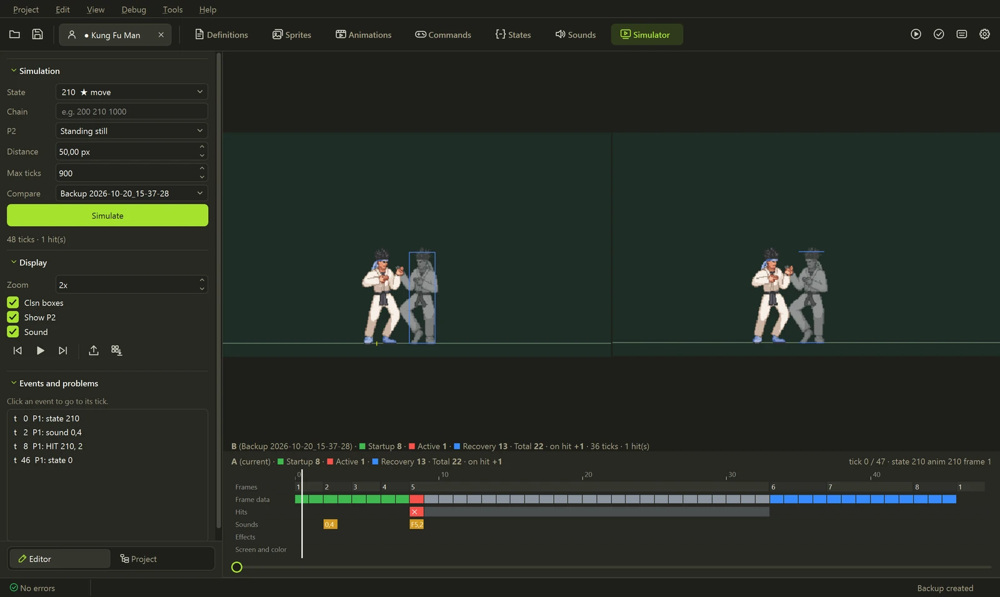

<kbd>F9</kbd> runs a state tick by tick, with helpers, explods and hit pauses, and measures startup,
active and recovery frames and the advantage on hit or guard. Pick a backup in **Compare** and both
versions play side by side. P2 can stand, guard, crouch or be in the air, and moves chain into combos.

### A timeline that edits the code

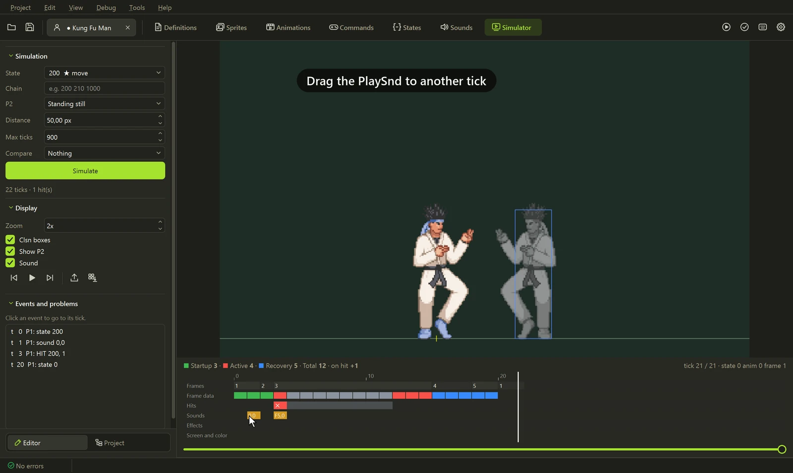

Every frame, hit, sound and effect of a move on one track. Drag a sound or an effect to another tick
and its trigger is rewritten (`Time = N`, `!Time` or `AnimElem = N`); double-click any event to open
its controller.

### Collision boxes in one click

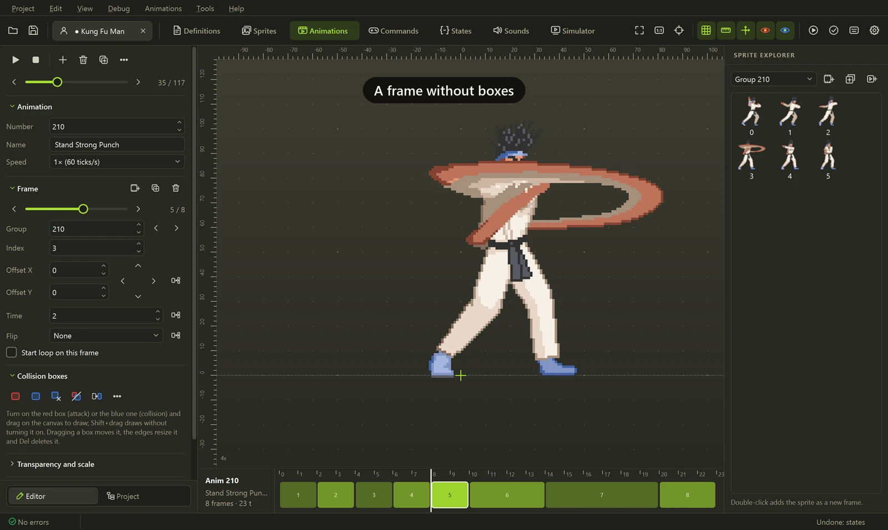

Anatomical Clsn2 (head, torso, legs) from the sprite's silhouette, the attack Clsn1 on an extended
limb, and boxes interpolated between two key frames.

### Command palette and go to definition

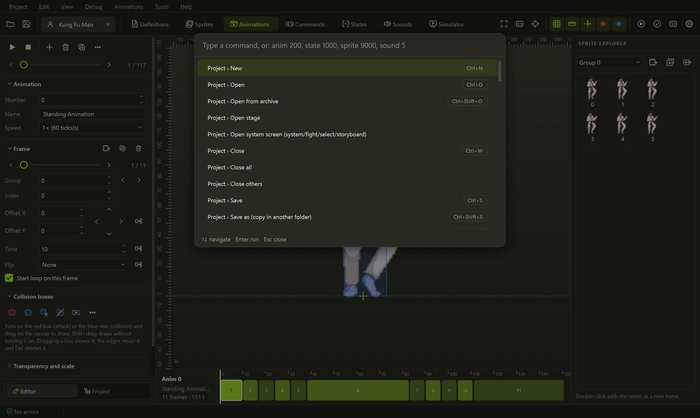

<kbd>F1</kbd> runs any command or jumps to `anim 200`, `state 1000`, `sprite 9000,0` or `sound 5,0`.
In the code, <kbd>F12</kbd> or <kbd>Ctrl</kbd>+click opens the definition under the cursor.

### And the tools around them

<table>
  <tr>
    <td width="50%" valign="top">
      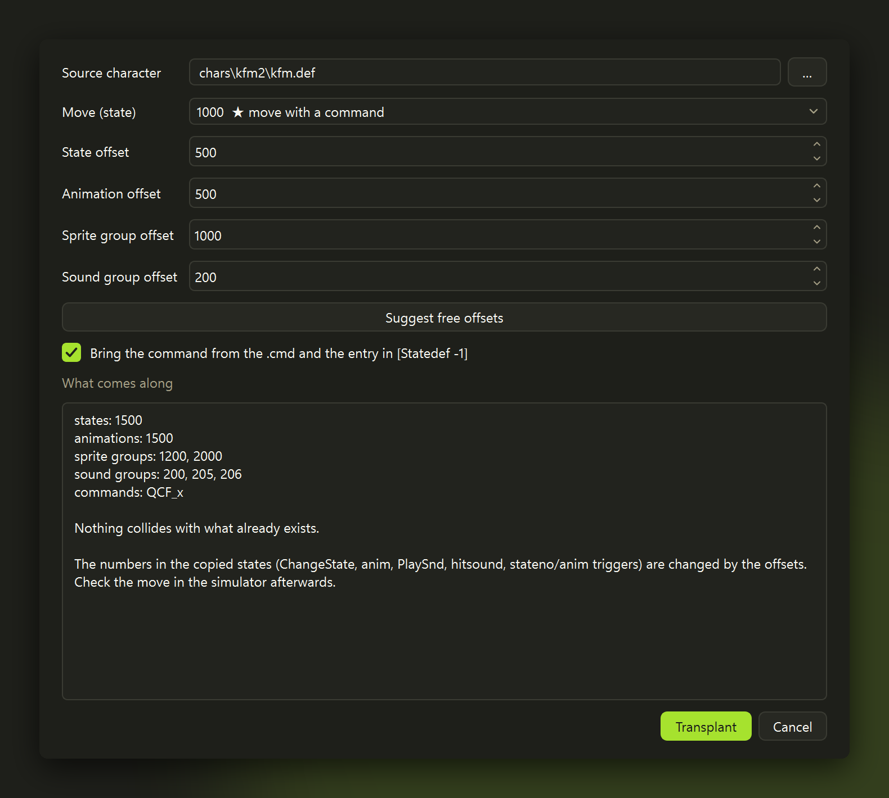<br>
      <b>Move transplant</b><br>
      Copies a whole move from another character, following <code>ChangeState</code>,
      <code>Helper</code> and <code>p1/p2stateno</code>, with its animations, sprites, sounds and
      command, renumbered so nothing collides.
    </td>
    <td width="50%" valign="top">
      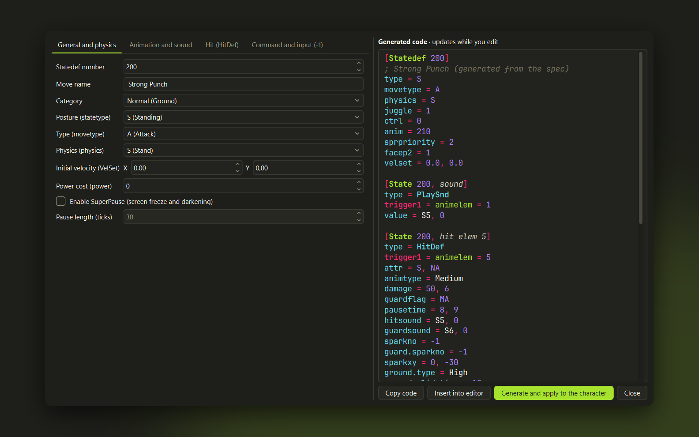<br>
      <b>Move wizard</b><br>
      Design a move visually (HitDef, physics, sounds, cancels, command) and watch the CNS being
      written as you edit.
    </td>
  </tr>
  <tr>
    <td width="50%" valign="top">
      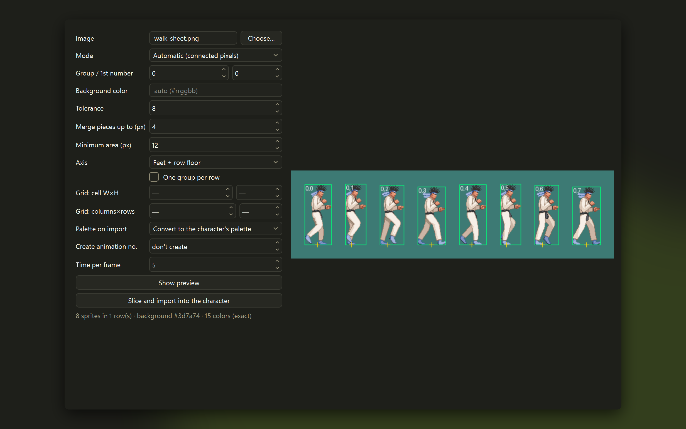<br>
      <b>Sprite sheet slicer</b><br>
      Finds the background and each frame, puts the axis on the feet and builds one palette, ready
      to import.
    </td>
    <td width="50%" valign="top">
      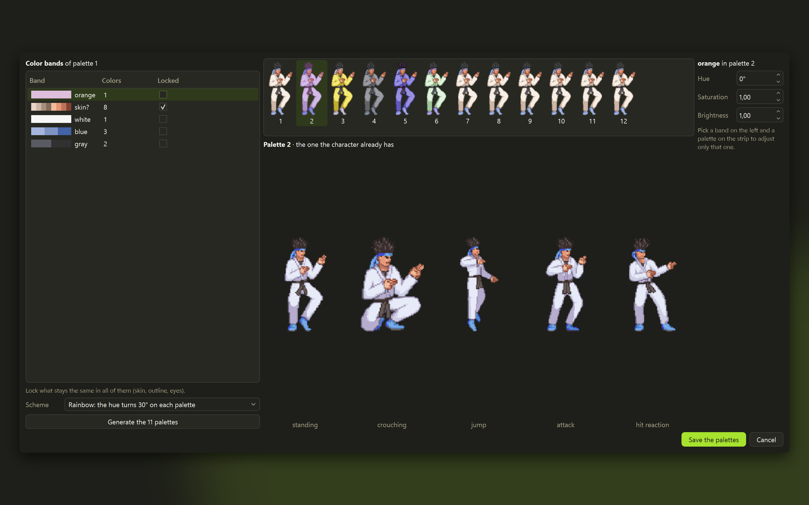<br>
      <b>One palette editor, 12 palettes by color bands</b><br>
      Every palette on one strip, color tools, a new palette previewed before saving, and a tab that
      locks what must not change (skin, outline) and generates palettes 2 to 12. Ctrl+Z inside.
    </td>
  </tr>
  <tr>
    <td width="50%" valign="top">
      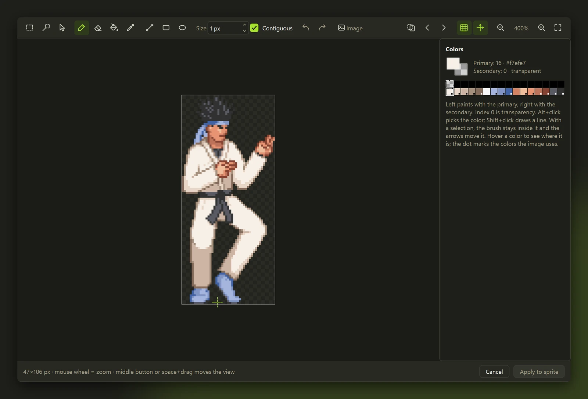<br>
      <b>Pixel editor on palette indices</b><br>
      <kbd>Ctrl</kbd>+<kbd>E</kbd>: selection, magic wand, outline, onion skin, and
      <kbd>PgUp</kbd>/<kbd>PgDn</kbd> through the sprites without closing it.
    </td>
    <td width="50%" valign="top">
      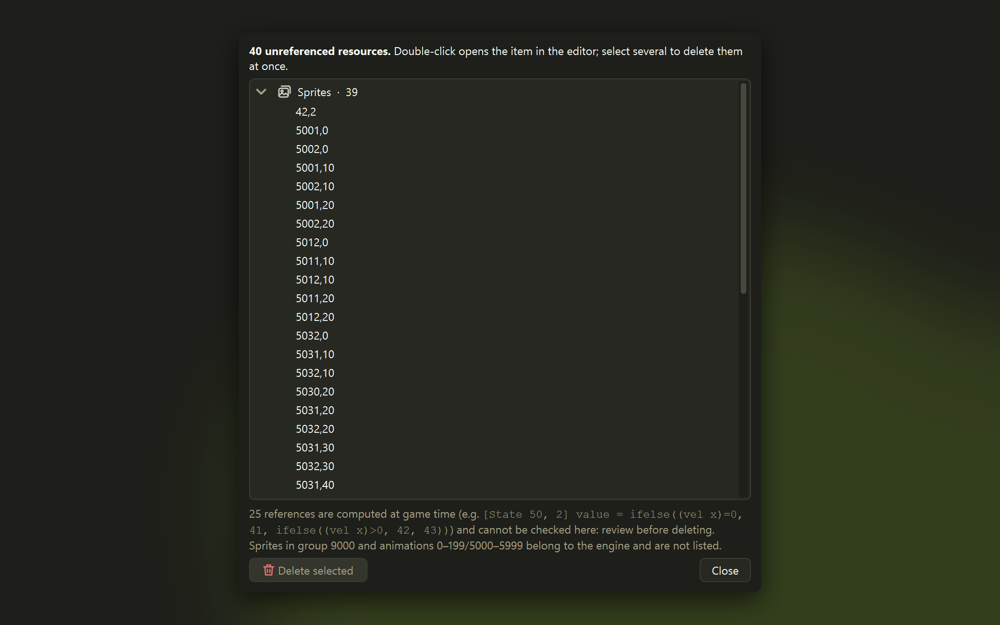<br>
      <b>Unused resources</b><br>
      Sprites, animations and sounds that nothing references, ready to delete before release.
    </td>
  </tr>
</table>

## The editors


Animations on a canvas with rulers, grid and axis, Clsn boxes drawn with the mouse, every frame on a
timeline sized by its duration, MUGEN 1.1 scale, angle and interpolation, and GIF export.

<table>
  <tr>
    <td width="50%" valign="top">
      <br>
      <b>Sprites and palettes</b><br>
      Import, export and align sprites, edit palettes and ACT files, or open a sprite in an
      external editor such as Aseprite.
    </td>
    <td width="50%" valign="top">
      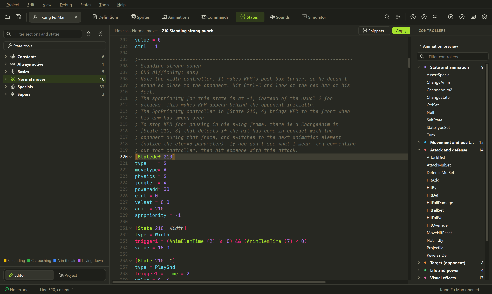<br>
      <b>Code</b><br>
      CNS, CMD, AIR and DEF with highlighting, docs on hover, snippets and live validation; comments
      are kept when saving.
    </td>
  </tr>
  <tr>
    <td width="50%" valign="top">
      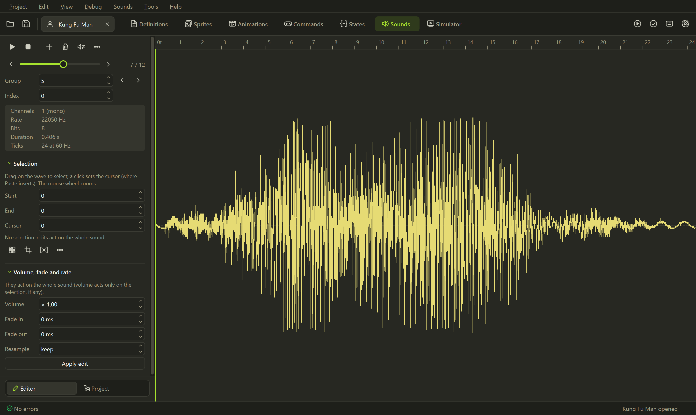<br>
      <b>Sounds</b><br>
      Play, cut, fade and resample on a ruler measured in game ticks; imports WAV, OGG, MP3 and FLAC.
    </td>
    <td width="50%" valign="top">
      <br>
      <b>Themes</b><br>
      Eight built-in themes, a theme editor and <code>.xml</code> colorset import.
    </td>
  </tr>
</table>

<details>
<summary><b>Everything else</b></summary>
<br>

- **Tools:** command tester, throw creator, PalFX editor, offset viewer, `[Statedef -1]` organizer,
  variable usage list, calculator and HTML move list export.
- **Stages:** layers, properties and a preview with camera and parallax.
- **Projects:** several characters in tabs, undo and redo everywhere, automatic backup, compare with a
  backup, find and replace in every file, open and pack `.zip` files.

</details>

### Supported formats

| Format | Read | Write |
|---|:---:|:---:|
| SFF v1.01 (PCX) and v2.00/2.01 (RLE8, RLE5, LZ5, PNG) | ✓ | ✓ <sub>(not RLE5)</sub> |
| AIR, CMD, CNS, ST, DEF <sub>(comments kept)</sub> | ✓ | ✓ |
| ZSS (Ikemen GO) | ✓ | ✓ |
| SND, ACT | ✓ | ✓ |
| ZIP, RAR, 7z (archived character) | ✓ | ZIP |

## Command line

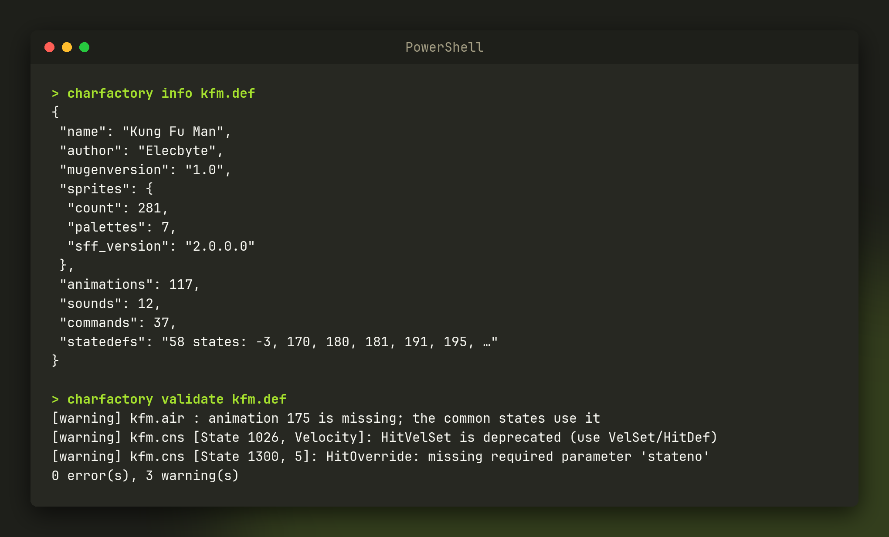

Everything the editor does to files also works from scripts or CI, no window needed:

```powershell
charfactory render kfm.def 200 out.gif    # render an animation
charfactory sim kfm.def 210 --gif         # simulate a state tick by tick
charfactory convert-sff in.sff out.sff --version 1
charfactory run kfm.def --engine ikemen    # a quick match in Ikemen GO (or mugen, or auto)
charfactory mcp kfm.def                   # MCP server over stdio, for agents (no window needed)
charfactory --help                        # every command
```

## Development

Needs Python 3.11 or newer.

```powershell
git clone https://github.com/eduardovbe/CharFactory.git
cd CharFactory
python -m venv .venv
.venv\Scripts\pip install -e ".[gui,test]"
.venv\Scripts\charfactory-gui
```

Tests, translations, building the executable and regenerating these screenshots are covered in
[CONTRIBUTING.md](CONTRIBUTING.md). Bug reports, translations and pull requests are welcome; please
follow the [Code of Conduct](CODE_OF_CONDUCT.md), and report security problems as described in
[SECURITY.md](SECURITY.md).

## License

[MIT](LICENSE). The bundled JetBrains Mono font is under the SIL Open Font License 1.1.

<sub>Inspired by Fighter Factory. Independent project, not affiliated with Elecbyte, the Fighter
Factory authors, Anthropic, OpenAI or Google. M.U.G.E.N is a trademark of Elecbyte. The screenshots
show Kung Fu Man, the sample character that ships with M.U.G.E.N.</sub>
